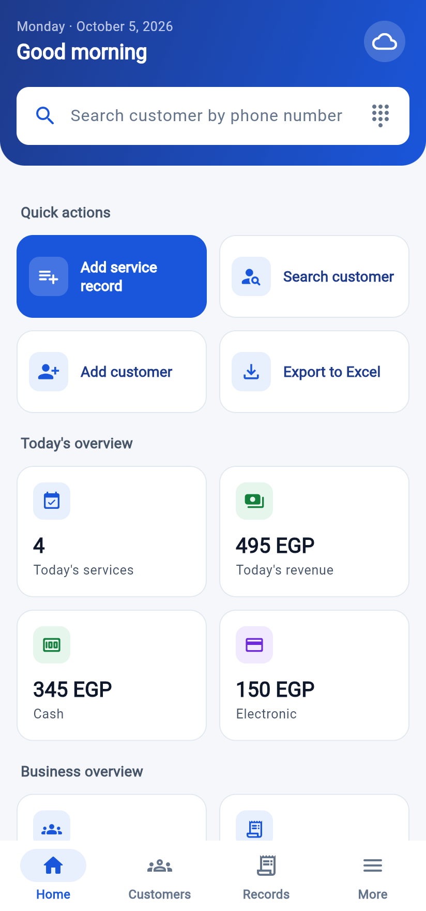
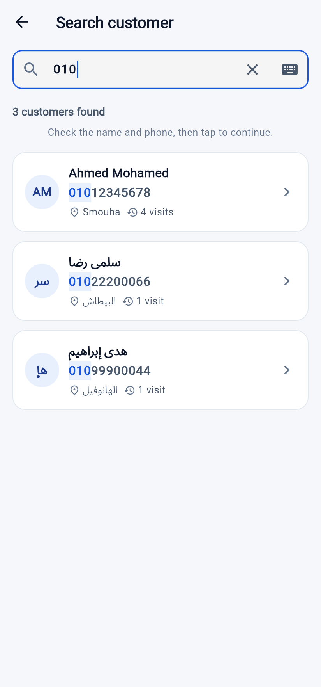
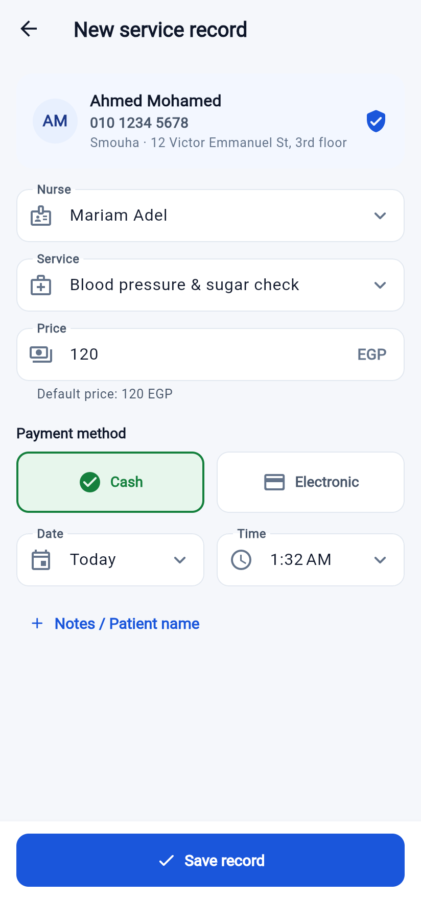
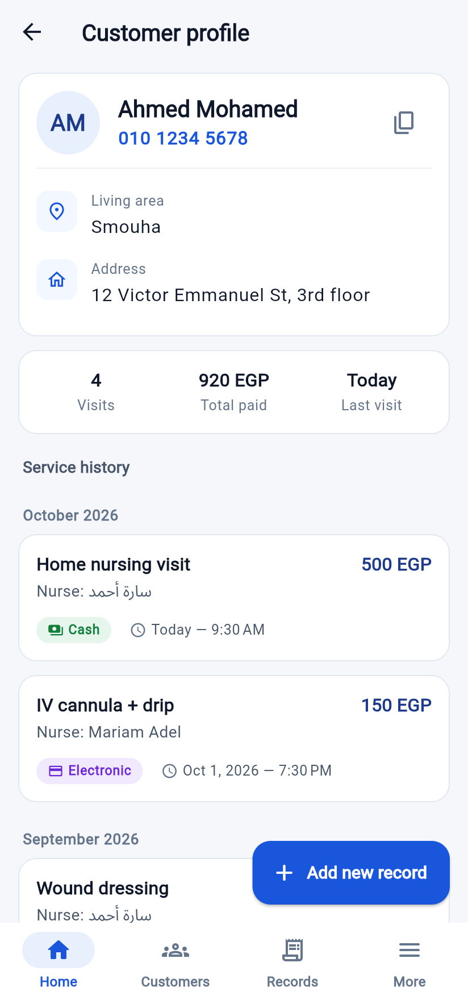
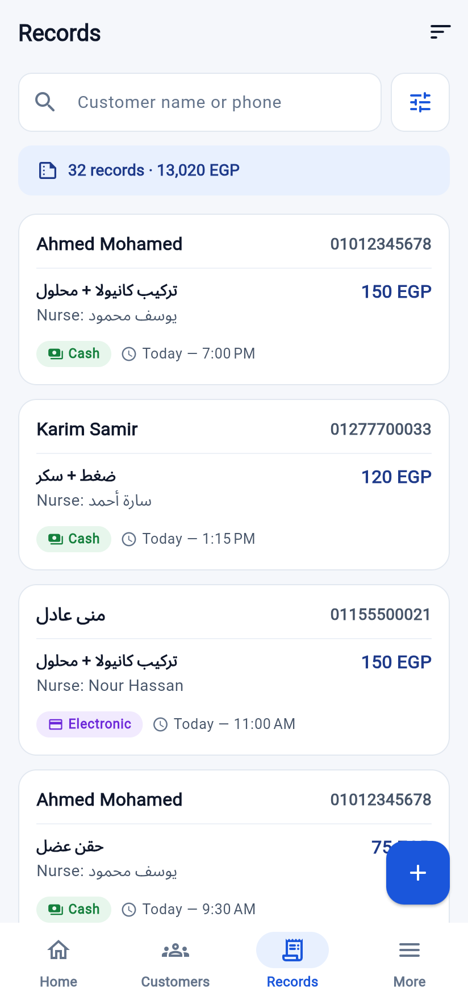
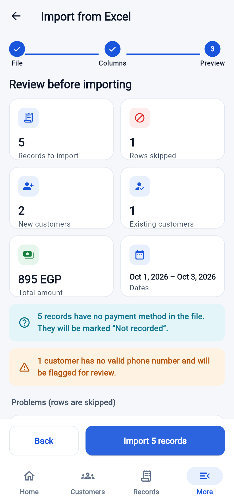
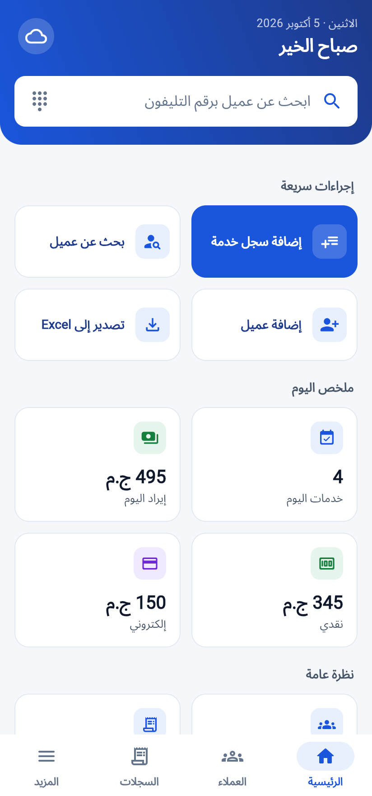
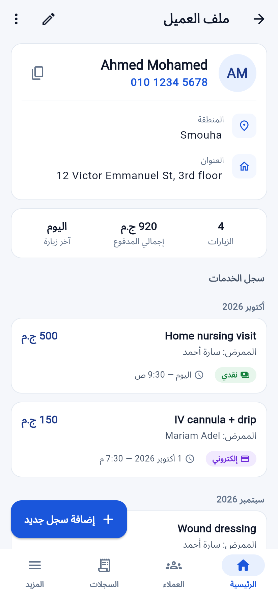
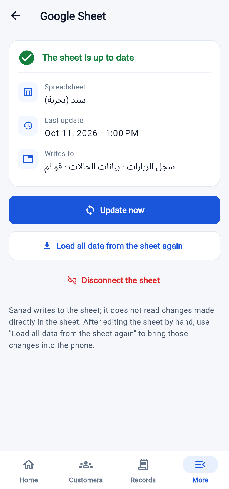
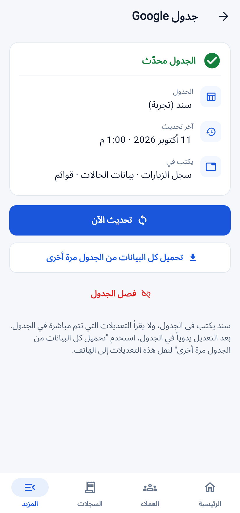

# Sanad · سند

**Customer & service-records app for home care, on your phone.**
Search a customer by phone, confirm, add the visit, save. Every service is kept
with full history on the phone and written into **your own Google Sheet** in
Google Drive a few seconds later: the same workbook you already use, with its
dashboard and formulas. Free, no server, no Google sign-in in the app. Excel
import/export is built in. Arabic and English.

<p>




</p>
<p>




</p>
<p>


</p>

*Screenshots use fictional demo data.*

## What's inside

| | |
|---|---|
| **App** (`app/`) | Flutter 3.47 · feature-first clean architecture (domain / data / presentation) · Cubit state management · get_it · go_router · Material 3 design system in Sanad blue · Arabic (RTL) + English · Android (also runs in a browser for a quick look) |
| **Data** | SQLite on the phone (`sqflite`): foreign keys, unique phone and names, frozen history, atomic and reversible Excel import. No server, no account. |
| **Google Sheet** | The user's own spreadsheet in Google Drive, through a small free script pasted into it (`tools/google-sheets/Code.gs`, deployed as a Web app). Sanad loads all of its data once, then writes every new or changed visit, customer, nurse, service and area into it. |
| **Docs** (`docs/`) | Workbook analysis, schema, architecture, user flows, design system, screen specs, testing, setup, security |
| **Tests** | Flutter tests (unit, cubit, widget, repository tests on real SQLite, and end to end against the real sheet script) and Node tests for the script, run in CI |

## Features

* **Phone-first search** (partial numbers, Arabic digits, `+20`, or name). Results show name, phone and area together.
* **Customers**: unique phone (duplicates are shown, never created), searchable areas with inline "Add new area", profile with full service history.
* **Service records**: nurse, service (default price suggested; actual price stored), Cash/Electronic, date/time defaulting to now, notes, patient name for family members.
* **History never changes**: price, nurse, service, area and address are frozen per record.
* **Records**: search, filters (date range, nurse, service, area, payment), sorting, live totals.
* **Nurses, services, areas**: managed in the app; deactivate instead of delete. The legacy price list and areas are preloaded.
* **Dashboard**: today's services and revenue (cash / electronic), totals, review alerts, Google Sheet state.
* **Google Sheet link**: paste the sheet's link once; Sanad loads everything from the sheet, then every new or changed record lands in the visits sheet (in the next free pre-numbered row, keeping its formulas), new customers in the customers sheet and new names in the lists. Works with any Google account and any phone; a second phone connects with a code.
* **Excel import**: auto-mapped columns, preview with row-level warnings, one transaction, rollback.
* **Excel export**: formatted workbook (Records with customer details, Customers, Nurses, Services, Areas), any period, shared from the phone.
* **Works offline**: everything is on the phone; only the sheet update needs a connection, and it retries by itself.
* **Privacy**: data stays on the phone and in the owner's spreadsheet; nothing is published.

## Quick start

```bash
cd app
flutter pub get
flutter run              # Android phone or emulator
```

To keep the data in a Google Sheet (5 minutes, once, on a computer):
[docs/08-deployment.md › Connecting the Google Sheet](docs/08-deployment.md#84-connecting-the-google-sheet-once-free).

Tests:

```bash
cd app && flutter analyze && flutter test
node --test tools/google-sheets/test/*.test.js     # the sheet script
```

## Documentation

1. [Excel workbook analysis & migration strategy](docs/01-excel-analysis.md)
2. [Database schema](docs/02-database-schema.md)
3. [Architecture & backend choice](docs/03-architecture.md)
4. [User flows](docs/04-user-flows.md)
5. [Design system](docs/05-design-system.md)
6. [Screen specifications](docs/06-screens.md)
7. [Testing strategy](docs/07-testing.md)
8. [Setup, Google Sheet & installing on a phone](docs/08-deployment.md)
9. [Security & privacy](docs/09-security.md)

## Repository layout

```
app/                      Flutter application
  lib/app/                composition root: DI, router, shell
  lib/core/               database, theme, widgets, errors, utils, storage
  lib/features/<feature>/ domain · data · presentation
  lib/l10n/               English & Arabic strings
  test/                   unit, cubit, widget, database and end-to-end tests
tools/google-sheets/      the script pasted into the Google Sheet (Code.gs),
                          its tests, and a local stand-in server for development
docs/                     project documentation
```

The Cairo font is bundled under the SIL Open Font License.
