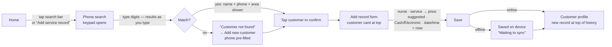

# 4. User flows

## 4.1 Primary flow: record a service for an existing customer

The design target is **under 20 seconds and as few taps as possible**.

| Step | Taps | Notes |
|------|------|-------|
| 1. Open search | 1 | Search bar at the top of Home. The numeric keypad opens automatically. |
| 2. Enter phone | — | Results appear after 3 digits. Partial numbers (`01012`, `5678`) and Arabic digits work. The typed digits are highlighted in each result. |
| 3. Confirm customer | 1 | Each result shows **name, phone, area and number of visits** together. |
| 4. Nurse | 2 | Searchable list (Arabic or English). Staff can add a missing nurse from the same list. |
| 5. Service | 2 | Shows each service's default price. Choosing one fills the price. |
| 6. Price | 0–1 | Edit only when the actual price differs. A typed price is never overwritten. |
| 7. Payment | 1 | Two large buttons: Cash / Electronic. |
| 8. Date & time | 0 | Default to now. Tap to change. |
| 9. Save | 1 | Validation errors appear next to each field. Draft is kept on failure. |

**Typical total: 8–9 taps.** After saving, the profile opens with the new
record on top, and with the cloud write already done (or queued offline).

## 4.2 Add a new customer

Home → **Add customer**, or Search → *Not found* → **Add new customer** (phone pre-filled).

1. Full name, phone (validated as an Egyptian number, ✓ shown when valid), living area, address (optional), notes (optional).
2. **Area** is a searchable list. Typing a missing name shows **+ Add “…”**,
   which creates the area and selects it. An existing spelling is reused,
   never duplicated.
3. **Save customer** →
   * phone already registered → a sheet shows the **existing customer** with
     *Add service record* / *View customer*. No duplicate is created.
   * otherwise → success screen with **Add service record**, **View customer**,
     **Back to home** (from the search flow it goes straight to *Add record*).

## 4.3 Look up history

Customers tab or search → profile: contact card, quick stats (visits, total
paid, last visit), and the **service history grouped by month**. Tap a record
for full details (nurse, service, price, payment, date/time, area and address
*at the time of the visit*, notes, created date, Excel row number for imported
rows).

## 4.4 Records, filters and reporting

Records tab → search by customer name or phone; **Filters**: date (today,
this week, this month, last month, custom range), nurse, service, area,
payment method; **Sort**: newest, oldest, highest/lowest price. A totals bar
shows the number of records and revenue for the current filter.

## 4.5 Administration

* **Nurses / Services / Areas** (More): list with active/inactive toggle.
  Staff can add. Admins edit, rename or deactivate, with confirmation.
  Inactive items stay in history but can't be picked for new records.
  Changing a service's default price never alters past records.
* **Users** (admin): invite (email, name, role), promote/demote,
  deactivate (with confirmation). An admin cannot lock themselves out.
* **Customer corrections** (admin): edit, archive/restore. *Needs review*
  customers (imported without a phone) are listed through the dashboard banner.
* **Record corrections** (admin): edit or archive (soft delete with audit log).

## 4.6 Excel import (admin)

More → Import from Excel →
1. **Choose file** (.xlsx).
2. **Columns**: the best sheet is picked automatically and its header row
   detected. Each app field shows the matched column, and any can be changed.
   Required: service date, price, and customer name or phone.
3. **Preview**: records to import, rows skipped, new vs existing customers,
   total amount, date range, rows without payment method, customers needing
   review, warnings and errors with **row numbers**, and new areas, nurses and
   services.
4. **Import**: confirmation, then one transaction, then a result summary.
5. **History**: every import with **Roll back** (confirmation).

## 4.7 Excel export (admin)

More → Export to Excel → period (all, this month, last month, custom) and
sheets (Records with customer details, Customers, Nurses, Services, Areas)
→ **Create Excel file** → share sheet (mobile) or download (web).

## 4.8 Account

* **Login** with email + password, **Forgot password** (e-mail link that opens
  the app on *Choose a new password*), **Sign out** (warns if records are
  still waiting to sync).
* **Session expired**: back to login with an explanation. Drafts are kept.
* **Profile**: name, role, change password.
* **Settings**: language (system / English / العربية), privacy note, version.
