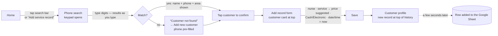
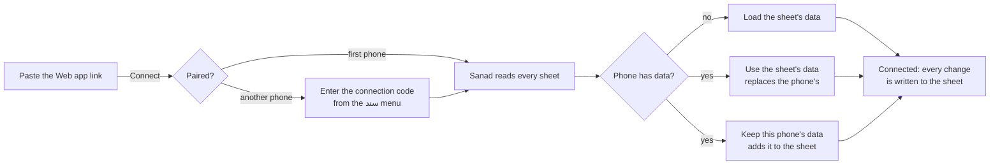

# 4. User flows

## 4.1 Primary flow: record a service for an existing customer

The design target is **under 20 seconds and as few taps as possible**.

| Step | Taps | Notes |
|------|------|-------|
| 1. Open search | 1 | Search bar at the top of Home. The numeric keypad opens automatically. |
| 2. Enter phone | — | Results appear after 3 digits. Partial numbers (`01012`, `5678`) and Arabic digits work. The typed digits are highlighted in each result. |
| 3. Confirm customer | 1 | Each result shows **name, phone, area and number of visits** together. |
| 4. Nurse | 2 | Searchable list (Arabic or English). A missing nurse can be added from the same list. |
| 5. Service | 2 | Shows each service's default price. Choosing one fills the price. |
| 6. Price | 0–1 | Edit only when the actual price differs. A typed price is never overwritten. |
| 7. Payment | 1 | Two large buttons: Cash / Electronic. |
| 8. Date & time | 0 | Default to now. Tap to change. |
| 9. Save | 1 | Validation errors appear next to each field. The draft is kept on the phone until saved. |

**Typical total: 8–9 taps.** Saving needs no connection; the Google Sheet is
updated on its own a few seconds later (or when the connection is back).

## 4.2 Add a new customer

Home → **Add customer**, or Search → *Not found* → **Add new customer** (phone pre-filled).

1. Full name, phone (validated as an Egyptian number, ✓ shown when valid), living area, address (optional), notes (optional).
2. **Area** is a searchable list. Typing a missing name shows **+ Add “…”**,
   which creates the area and selects it. An existing spelling is reused,
   never duplicated.
3. **Save customer** →
   * phone already registered → a sheet shows the **existing customer** with
     *Add service record* / *View customer*. No duplicate is created.
   * otherwise → success screen with **Add service record**, **View customer**,
     **Back to home** (from the search flow it goes straight to *Add record*).

## 4.3 Look up history

Customers tab or search → profile: contact card, quick stats (visits, total
paid, last visit), and the **service history grouped by month**. Tap a record
for full details (nurse, service, price, payment, date/time, area and address
*at the time of the visit*, notes, created date, Excel row number for imported
rows).

## 4.4 Records, filters and reporting

Records tab → search by customer name or phone; **Filters**: date (today,
this week, this month, last month, custom range), nurse, service, area,
payment method; **Sort**: newest, oldest, highest/lowest price. A totals bar
shows the number of records and revenue for the current filter.

## 4.5 Managing the data

* **Nurses / Services / Areas** (More): add, rename, deactivate. Inactive
  items stay in history but can't be picked for new records. Changing a
  service's default price never alters past records.
* **Customers**: edit, archive/restore. *Needs review* customers (imported
  without a phone) are reached from the dashboard banner or the filter on the
  Customers tab.
* **Records**: edit or archive.

## 4.6 Google Sheet link

Set up once on a computer (see [08-deployment.md › 8.4](08-deployment.md#84-connecting-the-google-sheet-once-free)):
the workbook becomes a Google Sheet and the Sanad script is pasted into it
and deployed as a Web app. Then, on the phone, More → **Google Sheet** (or
the banner / sheet icon on Home):

1. **Connect**: paste the link. Sanad shows what it found: records,
   customers, total amount, dates, skipped rows, customers needing review.
2. **Load the sheet's data** (a new phone), or, if the phone already has
   data, **Use the sheet's data** (replaces this phone's data, asks first) or
   **Keep this phone's data and add it to the sheet** (only if it is not in
   the sheet yet, otherwise visits would appear twice). An empty sheet simply
   receives the phone's data.
3. From then on every new or changed visit, customer, nurse, service and area
   is written into the sheet a few seconds after it is made, when the app
   goes to the background, and when the connection comes back. The screen
   shows the state (up to date / *n* changes waiting / could not be updated,
   with the reason), the last update, the sheets it writes to,
   **Update now** and **Load all data from the sheet again** (after editing
   the sheet by hand).
4. **Disconnect** stops the updates; the sheet and the phone's data stay as
   they are.

## 4.7 Excel import

More → Import from Excel →
1. **Choose file** (.xlsx).
2. **Columns**: the best sheet is picked automatically and its header row
   detected. Each app field shows the matched column, and any can be changed.
   Required: service date, price, and customer name or phone.
3. **Preview**: records to import, rows skipped, new vs existing customers,
   total amount, date range, rows without payment method, customers needing
   review, warnings and errors with **row numbers**, and new areas, nurses and
   services.
4. **Import**: confirmation, then one transaction, then a result summary.
5. **History**: every import with **Roll back** (confirmation).

## 4.8 Excel export

More → Export to Excel → period (all, this month, last month, custom) and
sheets (Records with customer details, Customers, Nurses, Services, Areas)
→ **Create Excel file** → share sheet (WhatsApp, e-mail, Drive…) on the
phone, download on the web.

## 4.9 Settings

Language (system / English / العربية), privacy note, version.
